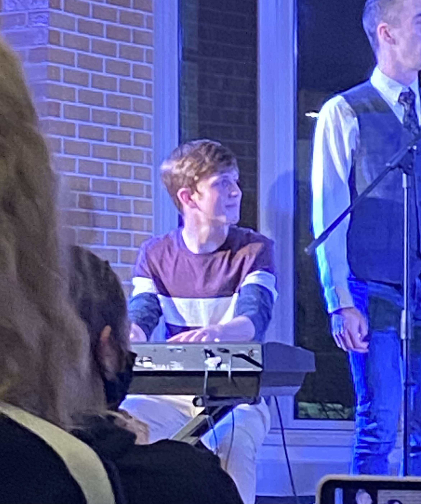

In college I played piano in a band of math majors called [Heine Borel and the Finite Subcovers](https://math.nd.edu/news/math-and-music/). 
We played songs about topics like the [Intermediate Value Theorem](https://youtu.be/qzVOMhKgUYU?si=mYAUAGz9q9pdebfn), [imaginary numbers](https://youtu.be/IPOVgwqeMs0?si=ljvjaE6Fh2kDcx6o), and the [dodecahedron](https://youtu.be/KF82LR9VZrw?si=HL1gFAD5n7jr7yN5).
Our post-graduation world tour never materialized, so most of us went to grad school instead.

